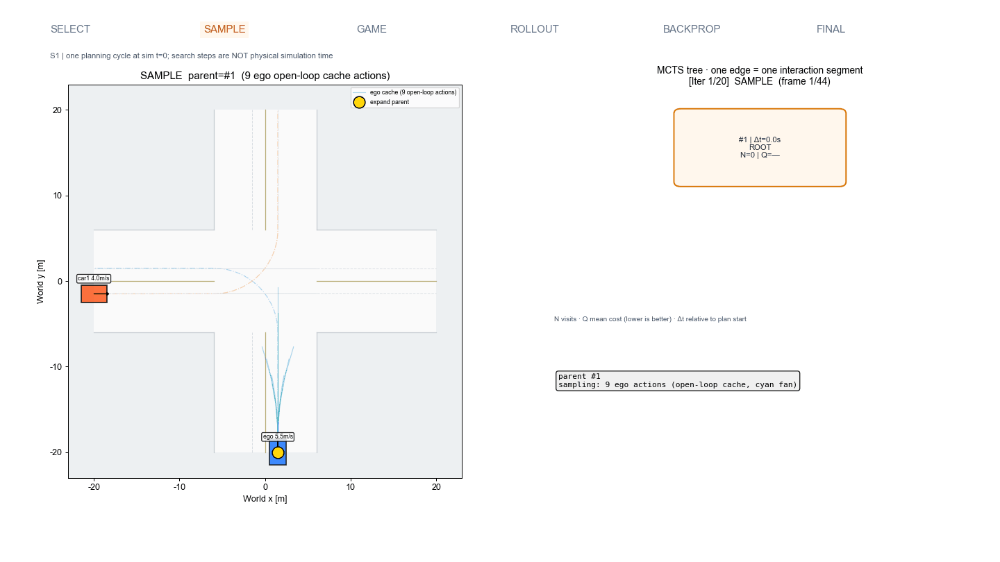
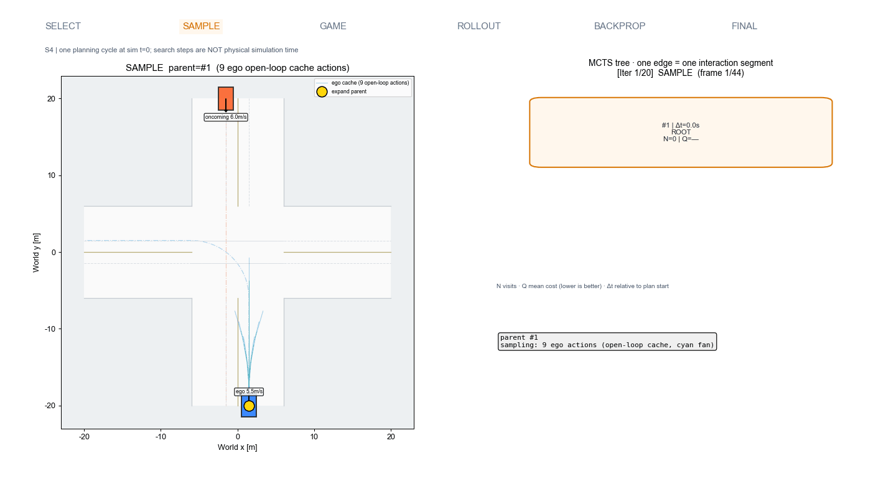
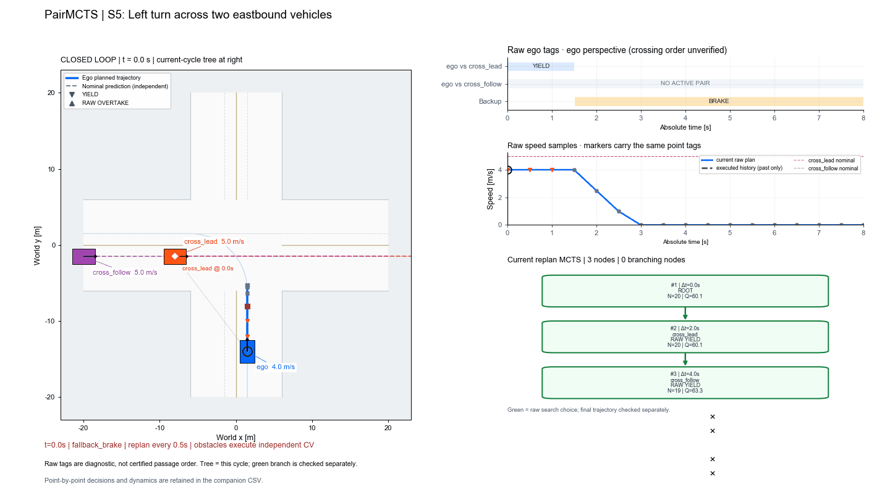
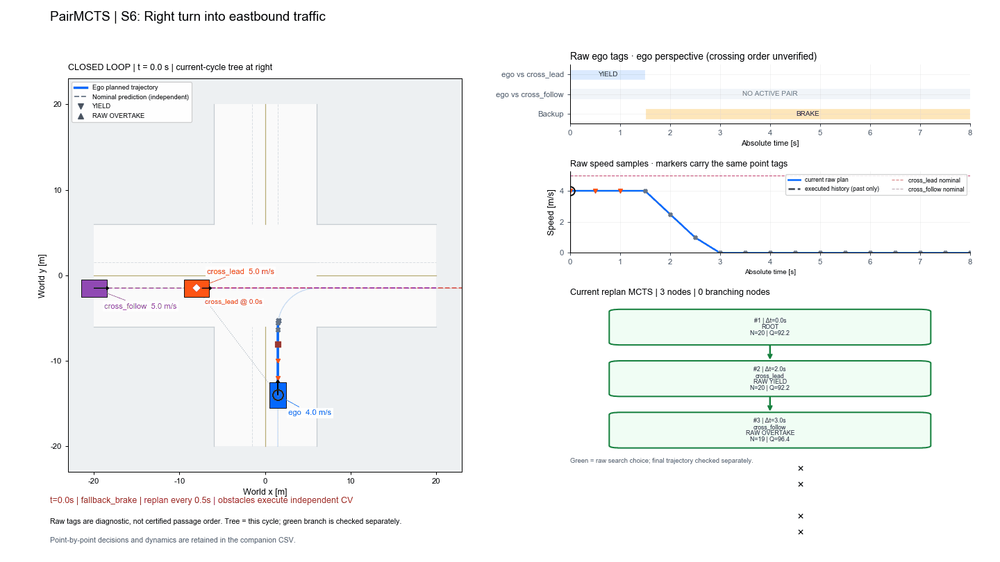
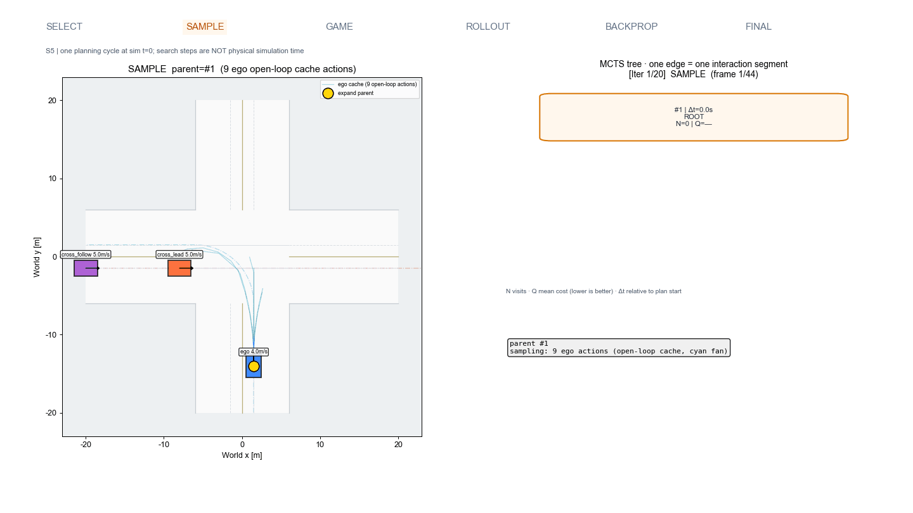
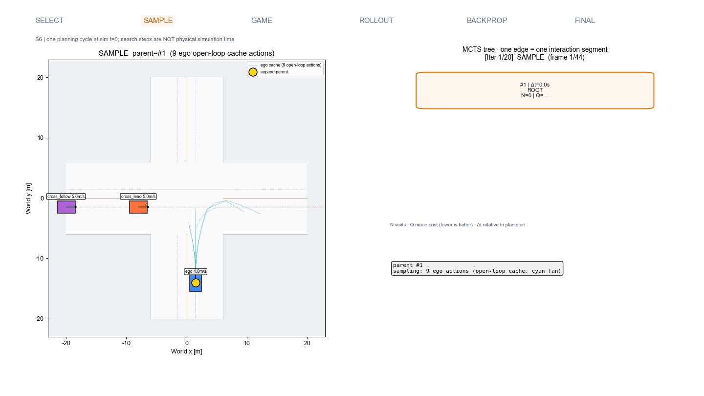
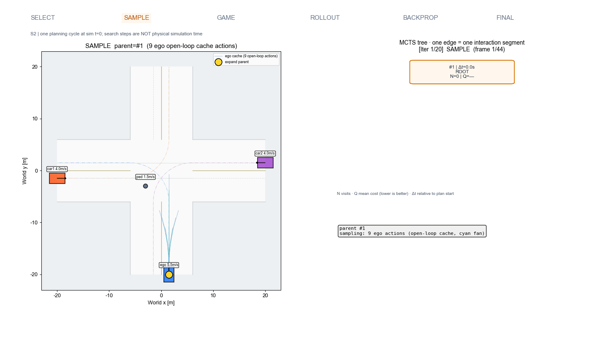
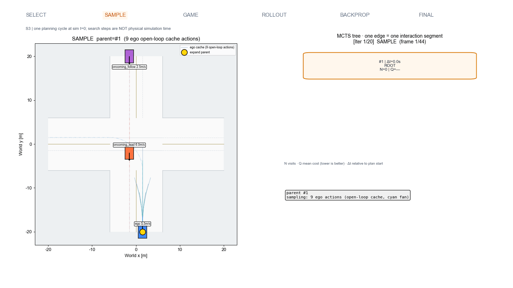

# interactive-planning-lab

Visual demos of interactive decision-making (MCTS), geometric search (Hybrid A*), and trajectory optimization (iLQR) for autonomous driving.

This repo is a **showcase**, not a third copy of the algorithms — short GIFs, short tech cards, links to source.

## Contents

- [InteractMCTS — lane-change vertical slice](#interactmcts--lane-change-vertical-slice)
  - [Casebook (C1–C10)](#casebook-definitions-c1c10)
  - [Closed-loop demos](#closed-loop-demos)
- [InteractMCTS — unprotected left turn (ULT)](#interactmcts--unprotected-left-turn-ult)
  - [Casebook (L1–L8)](#casebook-definitions-l1l8)
  - [Closed-loop demos](#closed-loop-demos-u6--u7)
- [PairMCTS](#pairmcts)
- [Hybrid A* — perpendicular parking](#hybrid-a--perpendicular-parking)
- [Hybrid A* — ROS / RViz parking (ROSParking)](#hybrid-a--ros--rviz-parking-rosparking)
- [DDP / iLQR — trajectory optimization](#ddp--ilqr--trajectory-optimization)
- [Coming next](#coming-next)
- [Layout](#layout)

---

## InteractMCTS — lane-change vertical slice

**Semantic MCTS for lane change:** sticky gap selection → variable-duration actions (`WAIT` / `ALIGN` / `CommitINSERT` / `ContinueCommit` / `AbortNow`) → hard safety gate (collision / gap / TTC) → closed-loop S8.

Default setup: dual-lane road, left lane change, Frenet planning on a reference path, Cartesian display. Output: ~8 s coarse trajectory (`dt = 0.5 s`) + semantic schedule + single sticky `gap_id`.


Refreshed 2026-10-29: all C1–C10 recordings use the synchronized **decision evidence dashboard**: current-cycle tree, root N/Q, reconstructed costs, masked actions with reasons, current plan and executed history. Final raw WAIT can mean target-lane HOLD after a completed merge.

**Measured limits:** C3 and C10 reach the target lane but subsequently overlap with scripted followers (13 and 9 samples on a 0.1s interpolated OBB grid). They are diagnostics, not whole-run safe successes. C4 has scripted non-ego overlaps; C7 uses an injected blocking hook. Start with C9 for ALIGN/commit behavior, then C7 for abort handling. See the [fresh run index and audit](assets/InteractMCTS_review/README.md).

### Casebook definitions (C1–C10)

| Case | Name | Setup / intent | Expected behavior |
|------|------|----------------|-------------------|
| **C1** | Comfortable gap | Wide Follow–Lead spacing, mild relative speed | Should reach **CommitINSERT** and merge |
| **C2** | Tight gap | Gap just above threshold; scoring / gate boundary | Borderline insert or careful align; easy to flicker |
| **C3** | Follow always keep | Open-loop constant-speed follower baseline | Legal insert when geometry allows |
| **C4** | Follow blocks from start | Follower accelerates and closes the gap | **Defer**: WAIT / ALIGN, do not force insert |
| **C5** | Gap disappears mid-run | Sticky Follow leaves the target lane / gap invalid | Must **reselect gap** or defer |
| **C6** | Two near-tied gaps | Top-2 scores almost equal | Sticky gap should **avoid chattering** |
| **C7** | Block mid-INSERT | Enter CROSSING, then Follow switches keep→block | **AbortNow**, return to ego lane if feasible |
| **C8** | Curved reference (R≈90 m) | Cubic-spline Frenet ↔ Cartesian; never assume \(x \equiv s\) | Same decision logic on a curve |
| **C9** | No same-lane lead · speed up into gap | Free ego lane; gap center ahead / faster → ALIGN accelerate then insert | Auto speed-up then CommitINSERT |
| **C10** | No same-lane lead · slow into gap | Free ego lane; gap center behind / slower → ALIGN decelerate then insert | Auto slow-down then CommitINSERT |

### Closed-loop demos

#### C1 — comfortable gap (insert)


#### C2 — tight gap


#### C3 — follow always keep (diagnostic: later ego overlap)


#### C4 — follower blocks from the start (defer)


#### C5 — gap disappears mid-run


#### C6 — two near-tied gaps (sticky)


#### C7 — block mid-INSERT (abort)


#### C8 — curved reference


#### C9 — no same-lane lead, accelerate into gap


#### C10 — decelerate into gap (diagnostic: later ego overlap)


### Tech card

| | |
|---|---|
| **Problem** | Lane-change gap acceptance / insert / abort under interactive followers |
| **Method** | Sticky gap + semantic variable-duration MCTS + hard gate; closed-loop S8 |
| **Demo** | Casebook C1–C10 closed-loop GIFs |
| **Output** | Semantic schedule + coarse ego trajectory + tags |
| **Limitations** | Python research demo; simplified opponent models; not production / Orin / real perception |
| **Source** | Private research repo `InteractMCTS` — demos published here |

---

## InteractMCTS — unprotected left turn (ULT)

**Semantic MCTS for unprotected left:** conflict-zone geometry → opposing **time** gaps + sticky gap* → `WAIT` / `CREEP` / `GO` → GO hard gate (VRU stub + keep∧block) → closed-loop U7 (replan every 0.5 s).

Default setup: PairMCTS-style 4-way cross; ego left-turn ref × opposing southbound; fixed intersection camera. Output: rolling 0.5 s decisions under perfect control over ~20 s.


Refreshed 2026-10-29: all L1–L8 recordings include the **current-cycle tree, actual GO gate rejection reasons, cached keep/block occupancy windows and estimated CV gap**. Search Q is an average total cost; the selected reconstructed trajectory cost is shown separately. Snapshots are end-of-cycle search results, not iteration replays.

**Measured limits:** L8 passes the whole-occupancy mid-gap test with 0.4s margins on both sides under the prototype interval model. L5 selects the mid-gap but does not thread it. L4/L5 have late scripted-actor overlaps at the finite reference endpoint. These are perfect-tracking prototype experiments, not proof of superiority over Europa or a continuous safety certificate. See the [fresh run index and audit](assets/InteractMCTS_review/README.md).

### Casebook definitions (L1–L8)

| Case | Name | Setup / intent | Expected behavior |
|------|------|----------------|-------------------|
| **L1** | Comfortable time gap | Sparse / slow oncoming | **GO** and clear the conflict zone |
| **L2** | Opposing arrives first | Oncoming already occupies CZ | **Yield** (WAIT/CREEP) until clear |
| **L3** | Opposing already cleared | Oncoming past \(s_{\mathrm{exit}}\) | **GO** with little wait |
| **L4** | Narrow time gap | Mid-gap just above margin | Boundary / observational |
| **L5** | Sticky mid-gap | Two oncoming cars; mid seam scores best | Locks sticky `opp_1__opp_2` at t=0 (select gap; may not thread) |
| **L6** | Creep to observe | Same blocking opp as L2; ego farther from STOP | Prefer **CREEP**, stay out of CZ while occupied |
| **L7** | Opposing rushes gap | Comfortable gap at t=0; opp accelerates once ego commits | Delayed commit, then finish left turn |
| **L8** | Thread mid gap | Wide legal mid-gap between opp_1 and opp_2 | **GO through** the seam (opp_1 cleared, opp_2 not yet in) |

### Closed-loop demos (U6 / U7)

#### L1 — comfortable time gap (GO)


#### L2 — opposing arrives first (yield)


#### L3 — opposing already cleared (GO)


#### L4 — narrow time gap


#### L5 — sticky mid-gap selection (not threaded in this run)


#### L6 — creep to observe


#### L7 — opposing rushes the gap


#### L8 — thread between opp_1 and opp_2


### Tech card

| | |
|---|---|
| **Problem** | Unprotected left vs oncoming traffic (time-gap acceptance / creep / go) |
| **Method** | Ref-line conflict disk + sticky time gap* + WAIT/CREEP/GO MCTS + keep∧block hard gate; closed-loop U7 |
| **Demo** | Casebook L1–L8 closed-loop GIFs (~20 s, `dt = 0.5 s`) |
| **Output** | Per-cycle macro + sticky gap* + executed coarse trajectory |
| **Limitations** | Python research demo; scripted / hooked opponents; VRU is a stub; not production / Orin / real perception |
| **Source** | Private research repo `InteractMCTS` — demos published here |

---

## PairMCTS

Pairwise **Level-1 game evaluation inside MCTS** for intersection decisions. Each expansion samples ego actions, evaluates opponent actions, groups the surviving trajectories into raw yield/overtake representatives, then continues with another interaction object. A tree edge covers an interaction segment, not a fixed 0.5 s control tick.

These recordings use **seed 0, 20 search iterations per replan, an 8 s planning horizon and 0.5 s replanning over 20 s**. Obstacles execute independent constant-velocity paths; the imagined game responses are not executed by other agents. The four existing scenario definitions and planning weights were retained.

The refreshed closed-loop recordings show the **current-cycle tree**, raw semantic timeline, planned versus executed speed, and final trajectory validation status. Cards show the interaction object, raw decision, plan-relative time, visits **N** and average cumulative cost **Q** (lower is better). Green is the raw search choice; safety repair can replace that trajectory. Separate search recordings show SELECT → SAMPLE → GAME → ROLLOUT → BACKPROP → FINAL, with historical visits/costs and actual candidate-filter counts.

### Start here: S4 — single oncoming vehicle

A clean example of ego deceleration, waiting/restart, and independent-prediction validation. The initial search tree has **2 nodes and no branching node** after filtering: this is useful for explaining the pipeline, not evidence of a large combinatorial search or superiority over a rule planner.


### Explain the search: S1 — crossing left-turner

The initial tree retains **two competing raw semantic representatives**: 3 nodes and 1 branching node. The GAME panel exposes the action-pair filtering; the following frames show rollout, UCB selection and N/Q updates. Search animation time is not physical simulation time.



<details>
<summary>S1 closed-loop behavior</summary>


</details>

<details>
<summary>S4 single-cycle search: heavily pruned tree</summary>



</details>

### New cross-traffic scenarios — S5 and S6

Rerun with seed 0, 20 iterations per cycle and 20s of closed-loop simulation. Both horizontal vehicles travel west to east at 5m/s, initially 12m apart. The through-traffic route now extends beyond the displayed intersection, avoiding artificial parking at x=20m.

**S5: ego turns left across two consecutive straight-driving vehicles.**



**S6: ego turns right into the same eastbound lane as both straight-driving vehicles.**



<details>
<summary>Single-cycle MCTS search traces for S5 and S6</summary>





</details>

These are scripted-traffic research demos with safety-braking overrides, not a claim of successful middle-gap acceptance or production readiness. Ego still has a finite reference endpoint; the later zero-speed clamp is not a physically optimized stopping maneuver. Fresh measurements, source/configuration digest and media hashes are in the [S5/S6 manifest](assets/pairmcts/manifest_scenarios_5_6.json). The regression suite passed 116 tests.

S5 measured: sampled ego overlaps=0, non-ego overlaps=0; exit observed=True, first exit sample=9.0s (ego center x <= -15m).

S6 measured: sampled ego overlaps=0, non-ego overlaps=0; exit observed=True, first exit sample=8.5s (ego center x >= 15m).

### Diagnostic scenes: useful limits, not polished success claims

<details>
<summary>S2 — multi-actor stress test: sequential pairs and safety overrides</summary>

Initial tree: **5 nodes, 1 branching node, depth 3**. This synthetic scene tests multiple interaction objects and the final safety fallback. Its diagonal point-mass pedestrian and independent scripted vehicles are not a physically coordinated traffic model. The audit detects **26 interior non-ego overlap samples at 0.1 s resolution**, even though no ego overlap was observed. Do not present it as validated pedestrian interaction or whole-scene collision freedom.




</details>

<details>
<summary>S3 — two oncoming vehicles: a gap opportunity that is not threaded in this run</summary>

Initial tree: **3 nodes, no branching node, depth 2**. The measured ego occupancy is not wholly between the lead vehicle clearing and the following vehicle entering the declared diagnostic disk (center `(-1.5, 0) m`, radius `3 m`). This is **not a successful middle-gap demonstration**. Late pile-up of the scripted oncoming vehicles occurs at the finite reference endpoint; the audit reports boundary-band overlaps separately from interior traffic conflicts.




</details>

### What the recordings establish

All four runs reached the declared exit sample, and no ego overlap was found on **0.1 s interpolated executed-motion samples** using the demo geometry. The fresh regression suite also passed; exact results, configuration, source digest and media hashes are in the [manifest](assets/pairmcts/manifest.json) and [asset index](assets/pairmcts/README.md).

The experiments demonstrate the search/validation pipeline, branch allocation in S1, sequential interaction processing in S2, and explicit failure/repair diagnostics. They do **not** establish a performance gain over Europa or rule planning: there is no matched baseline, closed-loop responsive opponent model, uncertainty sweep or planning-latency benchmark here. Raw quadrant-based labels may disagree with geometric passage order; `RAW OVERTAKE` is not a certified “ego passes first” result. Reference-end speed clamps remain a known comfort artifact; collision checks do not certify dynamics or comfort.

Source remains in the research `PairMCTS` project. Only presentation assets and measured metadata are copied here.

---

## Hybrid A* — perpendicular parking

**Kinematic search for perpendicular parking:** state is rear-axle `(x, y, θ)`; motion primitives go forward and reverse; Reeds-Shepp analytic expansion when close; SAT collision on the vehicle polygon; gradient-descent smoother with re-check.

Same family as Nav2 **SmacPlannerHybrid** and Autoware open-space parking — not a lane-level planner.


Final path:


### Tech card

| | |
|---|---|
| **Problem** | Perpendicular bay parking with parked cars on both sides; goal is a pose, not a point |
| **Method** | Hybrid A* on a 0.5 m / 15° grid + Reeds-Shepp CSC + SAT OBB + curvature smoother |
| **Demo** | Search tree → raw path → drive-in GIF; static result PNG |
| **Output** | Collision-free `(x, y, θ)` path the bicycle model can follow |
| **Limitations** | Python demo; Ackermann (max steer 35°), not a ±90° forklift steer; no live lidar costmap |
| **Source** | Local repo `hybrid_a_star_avp_demo` (not copied here) |

---

## Hybrid A* — ROS / RViz parking (ROSParking)

**ROS Noetic** Hybrid A* parking stack in RViz: search a collision-free pose, then smooth. Same kinematic family as the Python bay-parking demo above; this is the Gazebo/RViz visualization recorded from [`ROSParking`](https://github.com/SongJiayu1/ROSParking).

[Watch the demo (mp4)](assets/ros_parking/hybrid_a_star_ros_noetic.mp4)

<video src="assets/ros_parking/hybrid_a_star_ros_noetic.mp4" controls width="800"></video>

### Tech card

| | |
|---|---|
| **Problem** | Parking / open-space pose planning with Hybrid A* in ROS |
| **Method** | `my_hybrid_astar`: 3D node search + Reeds-Shepp coarse path + spiral / FEM smoothers |
| **Demo** | ~36 s RViz screen recording (also in this folder as mp4) |
| **Stack** | ROS Noetic · `my_hybrid_astar` · `my_load_map` · `my_show_markers` |
| **Limitations** | Research / pre-study; not a production AVP stack |
| **Source** | [SongJiayu1/ROSParking](https://github.com/SongJiayu1/ROSParking) |

---

## DDP / iLQR — trajectory optimization

**Constrained iLQR / DDP** on a bicycle model: iterate a trajectory around obstacles while keeping tracking and smoothness costs. Demo recorded from [`myiLQR`](https://github.com/SongJiayu1/myiLQR).

[Watch the demo (mp4)](assets/ddp/ddp_ilqr.mp4)

<video src="assets/ddp/ddp_ilqr.mp4" controls width="800"></video>

### Tech card

| | |
|---|---|
| **Problem** | Short-horizon trajectory optimization with obstacles (not combinatorial search) |
| **Method** | DDP / CILQR; proximity cache; bicycle model |
| **Demo** | ~24 s screen recording |
| **Limitations** | Research demo; not production / Orin-timed as shown here |
| **Source** | [SongJiayu1/myiLQR](https://github.com/SongJiayu1/myiLQR) |

---

## Coming next

Nothing queued. New demos land here as GIFs or short mp4s, not as a third copy of the solver.

---

## Layout

```text
interactive-planning-lab/
├── README.md
└── assets/
    ├── InteractMCTS_lane_change/
    │   ├── C1_closed_loop.gif … C10_closed_loop.gif
    ├── InteractMCTS_ult/
    │   ├── L1_closed_loop.gif … L8_closed_loop.gif
    ├── pairmcts/
    │   ├── scenario_1_sim_20s_replan.gif
    │   ├── scenario_2_sim_20s_replan.gif
    │   ├── scenario_3_sim_20s_replan.gif
    │   ├── scenario_4_sim_20s_replan.gif
    │   ├── scenario_1_search.gif … scenario_4_search.gif
    │   └── manifest.json / README.md / *.png
    ├── hybrid_a_star/
    │   ├── parking_demo.gif
    │   └── parking_result.png
    └── ros_parking/
        └── hybrid_a_star_ros_noetic.mp4
    └── ddp/
        └── ddp_ilqr.mp4
```
